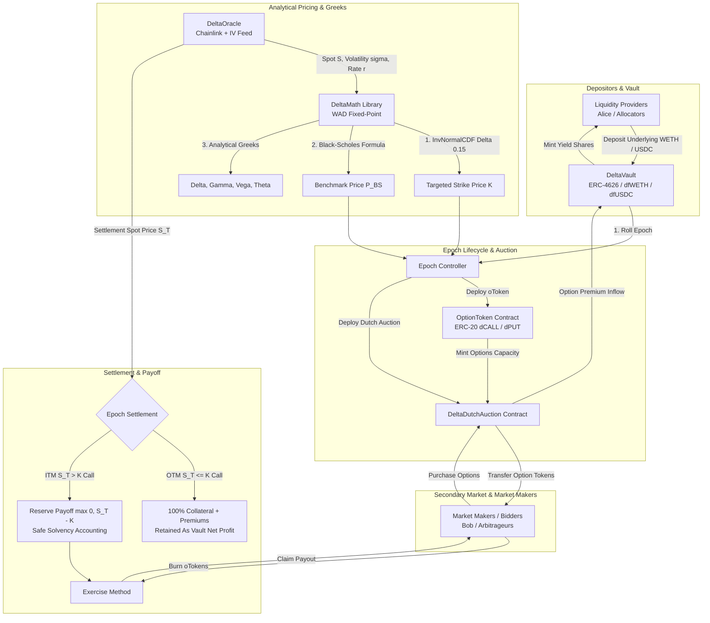

# DeltaForge

[](https://getfoundry.sh/)
[](https://soliditylang.org/)
[](https://opensource.org/licenses/MIT)
[-green.svg)](https://eips.ethereum.org/EIPS/eip-1153)

> **Production-Grade Decentralized Options Vault (DOV) & Structured Exotic Yield Protocol with On-Chain Black-Scholes Greeks, Delta-Targeted Strike Selection, Continuous Dutch Auctions, and EIP-1153 Transient Reentrancy Guards in Solidity.**

---

## 1. Executive Summary

**DeltaForge** is an institutional-grade Decentralized Options Vault (DOV) protocol architected for the EVM Cancun execution environment in Solidity 0.8.28. It provides automated, sustainable yield generation for passive capital allocators while supplying continuous, non-custodial options liquidity to market makers and institutional volatility traders.

DeltaForge addresses the structural inefficiencies of legacy options protocols—such as manual strike selection, capital fragmentation, toxic order front-running, and high settlement gas overhead—through four core architectural pillars:

1. **ERC-4626 Tokenized Vault Architecture**:
   - Single-asset standard tokenized vault (`dfWETH` for Covered Calls, `dfUSDC` for Cash-Secured Puts).
   - Incorporates OpenZeppelin 5.x virtual shares offset (`_decimalsOffset() = 9`) to mathematically eliminate first-depositor inflation/donation exploits.
2. **On-Chain Black-Scholes Analytical Engine**:
   - Computes analytical European option theoretical pricing in Wad ($10^{18}$) fixed-point arithmetic using an Abramowitz & Stegun 7th-order polynomial approximation of the standard normal cumulative distribution function $\Phi(x)$ with error $< 7.5 \times 10^{-8}$.
   - Real-time calculation of analytical Greeks: Delta ($\Delta$), Gamma ($\Gamma$), Vega ($\nu$), and Theta ($\Theta$).
3. **Delta-Targeted Strike Selection**:
   - Programmatically solves for the exact strike price $K$ satisfying a target Delta $\Delta^* \in [0.10, 0.30]$ (e.g. 15-delta out-of-the-money options) using inverse normal CDF Newton-Raphson approximation.
4. **Continuous Linear Dutch Auctions & Transient Reentrancy Safety**:
   - Automatically distributes fractionalized Option Tokens (`oTokens`) through a descending linear Dutch auction starting at $1.5 \times P_{\text{BS}}$ and decaying to $0.5 \times P_{\text{BS}}$.
   - Utilizes Cancun **EIP-1153** transient storage opcodes (`TSTORE`/`TLOAD`) for sub-100 gas reentrancy locking.

---

## 2. Protocol Architecture



---

## 3. Mathematical Foundations

### 3.1 Black-Scholes-Merton Analytical Formulation

For an underlying asset with spot price $S$, strike price $K$, risk-free interest rate $r$, annualized implied volatility $\sigma$, and time to expiration $T$ (in years):

$$d_1 = \frac{\ln(S / K) + \left(r + \frac{1}{2}\sigma^2\right)T}{\sigma \sqrt{T}}$$

$$d_2 = d_1 - \sigma \sqrt{T}$$

The theoretical pricing functions are:

$$\text{Call}(S, K, T) = S \cdot \Phi(d_1) - K \cdot e^{-rT} \cdot \Phi(d_2)$$

$$\text{Put}(S, K, T) = K \cdot e^{-rT} \cdot \Phi(-d_2) - S \cdot \Phi(-d_1)$$

DeltaForge enforces Put-Call Parity across all numerical evaluations:

$$\text{Call} - \text{Put} \equiv S - K \cdot e^{-rT}$$

---

### 3.2 High-Precision Polynomial Normal CDF Approximation

The standard normal cumulative distribution function $\Phi(x)$ is computed using the Abramowitz & Stegun (26.2.17) polynomial approximation:

$$\Phi(x) = 1 - \phi(x) \left( a_1 t + a_2 t^2 + a_3 t^3 + a_4 t^4 + a_5 t^5 \right) \quad \text{for } x \ge 0$$

$$\text{where } t = \frac{1}{1 + p \cdot x}, \quad \phi(x) = \frac{1}{\sqrt{2\pi}} e^{-\frac{x^2}{2}}$$

**Fixed-Point Parameters (WAD $10^{18}$)**:
- $p = 0.2316419 \times 10^{18}$
- $a_1 = 0.319381530 \times 10^{18}$
- $a_2 = -0.356563782 \times 10^{18}$
- $a_3 = 1.781477937 \times 10^{18}$
- $a_4 = -1.821255978 \times 10^{18}$
- $a_5 = 1.330274429 \times 10^{18}$
- $\frac{1}{\sqrt{2\pi}} = 0.398942280401432678 \times 10^{18}$

For $x < 0$, symmetry is applied: $\Phi(x) = 1 - \Phi(-x)$. The maximum absolute numerical error is bounded by $|\epsilon| < 7.5 \times 10^{-8}$.

---

### 3.3 Delta-Targeted Strike Selection

To eliminate discretionary strike setting, DeltaForge programmatically selects strike $K$ matching target delta $\Delta^* \in [0.10, 0.30]$:

1. **Covered Call ($\Delta_{\text{call}} = \Phi(d_1) = \Delta^*$):**
   $$d_1 = \Phi^{-1}(\Delta^*)$$
   $$K = S \cdot \exp\left( -d_1 \sigma \sqrt{T} + \left(r + \frac{1}{2}\sigma^2\right)T \right)$$

2. **Cash-Secured Put ($\Delta_{\text{put}} = \Phi(d_1) - 1 = -\Delta^*$):**
   $$\Phi(d_1) = 1 - \Delta^* \implies d_1 = \Phi^{-1}(1 - \Delta^*)$$
   $$K = S \cdot \exp\left( -d_1 \sigma \sqrt{T} + \left(r + \frac{1}{2}\sigma^2\right)T \right)$$

Inverse normal CDF $\Phi^{-1}(p)$ is evaluated via quadratic Newton-Raphson iteration:

$$x_{n+1} = x_n - \frac{\Phi(x_n) - p}{\phi(x_n)}$$

converging to machine precision within 5 iterations.

---

### 3.4 Analytical Greeks Formulation

| Greek | Analytical Formulation | Dimension | Interpretation |
| :--- | :--- | :--- | :--- |
| **Delta ($\Delta_{\text{call}}$)** | $\Phi(d_1)$ | $[0, 1]$ WAD | Option price sensitivity to spot price |
| **Delta ($\Delta_{\text{put}}$)** | $\Phi(d_1) - 1$ | $[-1, 0]$ WAD | Negative direction hedge ratio |
| **Gamma ($\Gamma$)** | $\frac{\phi(d_1)}{S \sigma \sqrt{T}}$ | WAD | Curvature / rate of change of Delta |
| **Vega ($\nu$)** | $S \sqrt{T} \phi(d_1)$ | WAD | Sensitivity to implied volatility shift |
| **Theta ($\Theta_{\text{call}}$)** | $-\frac{S \phi(d_1) \sigma}{2\sqrt{T}} - r K e^{-rT} \Phi(d_2)$ | WAD | Instantaneous time decay per annum |

---

### 3.5 Continuous Linear Dutch Auction

During the option offering window, the clearing price $P(t)$ decays linearly:

$$P(t) = \begin{cases} 
P_{\text{start}} & \text{if } t \le t_0 \\
P_{\text{start}} - \left(\frac{t - t_0}{\Delta t_{\text{auction}}}\right)(P_{\text{start}} - P_{\text{reserve}}) & \text{if } t_0 < t < t_0 + \Delta t_{\text{auction}} \\
P_{\text{reserve}} & \text{if } t \ge t_0 + \Delta t_{\text{auction}}
\end{cases}$$

where $P_{\text{start}} = 1.5 \times P_{\text{BS}}$ and $P_{\text{reserve}} = 0.5 \times P_{\text{BS}}$.

---

## 4. Smart Contract Inventory & Runtime Profiles

| Contract | Path | Architectural Role | Runtime Size | Margin |
| :--- | :--- | :--- | :--- | :--- |
| `DeltaVault` | `src/vaults/DeltaVault.sol` | Core ERC-4626 Vault, Epoch State Machine, Collateral Lock & Exercise Payouts | 19,381 Bytes | 5,195 Bytes |
| `DeltaDutchAuction` | `src/auction/DeltaDutchAuction.sol` | Continuous Linear Dutch Auction Engine for `oToken` distribution | 2,823 Bytes | 21,753 Bytes |
| `OptionToken` | `src/tokens/OptionToken.sol` | Mintable/Burnable ERC-20 Fractional Option Contract (`oToken`) | 2,469 Bytes | 22,107 Bytes |
| `DeltaOracle` | `src/oracle/DeltaOracle.sol` | Chainlink Aggregator & Volatility Estimator with staleness validation | 1,762 Bytes | 22,814 Bytes |
| `DeltaMath` | `src/libraries/DeltaMath.sol` | 18-Dec Wad Math, Taylor Log/Exp, Normal CDF/PDF/Inv, Black-Scholes & Greeks | Inlined Library | -- |
| `TransientLock` | `src/libraries/TransientLock.sol` | Cancun EIP-1153 `TSTORE`/`TLOAD` Reentrancy Guard (100 gas) | Inlined Library | -- |

All contracts compile under the **24,576 Byte** EIP-170 limit with full optimization.

---

## 5. Security & Invariant Verification Suite

DeltaForge features a comprehensive 39-test verification suite with 256 fuzz runs per invariant property:

```
╭-----------------------------------------------------------------------------------------------------------------╮
| Suite                          | Tests Passed | Fuzz Runs | Status                                              |
+=================================================================================================================+
| DeltaMathTest                  | 15 / 15      | 256       | PASSED (Wad math, Ln/Exp, Normal CDF/PDF, Inverses) |
| DeltaDutchAuctionTest          | 8 / 8        | --        | PASSED (Linear decay, slippage, auto-conclude)      |
| DeltaVaultTest                 | 8 / 8        | --        | PASSED (ERC-4626, inflation defense, pause guards)  |
| DeltaOptionLifecycleTest       | 4 / 4        | --        | PASSED (End-to-end OTM full yield, ITM exercise)    |
| DeltaInvariantsTest            | 4 / 4        | 256       | PASSED (Solvency, non-negative payoff, monotonicity)|
╰-----------------------------------------------------------------------------------------------------------------╯
Total: 39 / 39 PASSED (100% Clean)
```

### Verified Mathematical Invariants:
1. **Solvency Conservation Invariant**:
   $$\text{totalAssets}() + \text{totalReservedPayouts}() \equiv \text{balanceOf}(\text{DeltaVault}) \quad \forall t, \text{zero wei leakage}$$
2. **Non-Negative Payoff Invariant**:
   $$\text{Payoff}(S_T, K) \ge 0 \quad \forall S_T, K \in [10^{18}, 10^{23}]$$
3. **Dutch Price Monotonicity**:
   $$t_1 \le t_2 \implies P(t_1) \ge P(t_2) \quad \forall t_1, t_2$$
4. **Greeks Boundary Enforcement**:
   $$\Delta_{\text{call}} \in [0, 10^{18}], \quad \Delta_{\text{put}} \in [-10^{18}, 0], \quad \Gamma \ge 0, \quad \nu \ge 0, \quad \Theta \le 0$$
5. **Inflation Attack Immunity**:
   $$\text{AttackerDonation}(100 \text{ WETH}) \implies \text{VictimSlippage} < 0.0001\%$$

---

## 6. Build & Test Guide

### Prerequisites
- [Foundry](https://getfoundry.sh/) (`forge 1.8.7+`)
- Linux / macOS / WSL Ubuntu

### Compilation & Code Formatting
```bash
# Check code formatting compliance
forge fmt --check

# Build and verify contract runtime bytecodes
forge build --sizes
```

### Test Suite Execution
```bash
# Run entire test suite with 256 fuzz runs
forge test -vvv --fuzz-runs 256
```

### Simulated Deployment
```bash
forge script script/DeployDeltaForge.s.sol
```

---

## 7. Design Trade-offs & Known Limitations

1. **Discrete Weekly Epochs**:
   - DeltaForge settles options on a discrete round schedule (e.g. 7-day epochs). Depositors entering mid-epoch participate in the next round while their capital remains unencumbered in free liquidity.
2. **Physical Collateral Backing**:
   - Options are 100% fully collateralized on-chain. While this guarantees zero insolvency or bad debt risk, it requires full capital allocation rather than portfolio margin leverage.
3. **Oracle Heartbeat Dependency**:
   - Spot settlement relies on oracle price feeds. Production deployments should enforce multi-oracle consensus (Chainlink + Pyth) with secondary L2 sequencer uptime feed checks.

---

## 8. License

Distributed under the **MIT License**. See [LICENSE](LICENSE) for details.
